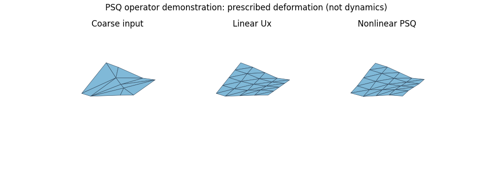

# Progressive Dynamics for Cloth and Shells

布料渐进动力学研究实现：**非线性 PSQ 延拓、层级生成与安全展开、Semi / Full / VelPro 时间更新，以及修改后的 libuipc CUDA 后端**。

本发布副本包含完整的当前后端源码与构建入口。最终生效的事件回退、PSQ 有序梯度、FEM 有序装配、GPU PCG 和 RMS 收敛检查源码已从历史构建目录整理到 `third_party/libuipc/`，构建不再需要原工作区的 `output/`、旧 `.obj`、DLL 或编译命令缓存。

## 同伴拿到后能做什么

| 入口 | 内容 | 所需环境 |
|---|---|---|
| `examples/psq_demo.py` | 非零 PSQ 偏移、形状恢复、刚体变换、速度导数与动画 | Python + 基础依赖；无需 GPU |
| `python -m progressive.run` | PSQ 渐进动力学、接触与安全层级展开 | Python + `requirements-progressive.txt` |
| `native/intrinsic_builder` | 从输入 OBJ 生成 intrinsic 映射、PSQ 层级和可逆展开历史 | CMake + C++17 编译器；依赖源码已随仓库提供 |
| `scripts/build_release_backend.py` | 从源码编译完整事件回退 CUDA 后端和 Python 绑定 | Windows、Python 3.11、MSVC 2022、CUDA、xmake |
| Bunny / Shirt 运行入口 | 使用上述后端运行实际场景 | 还需相应模型、PSQ 层级和驱动输入 |

`cloth/` 是早期线性延拓参考实现；下列推荐入口使用 `progressive/` 中的非线性 PSQ。

## 1. 安装 Python 环境并运行 PSQ

从仓库根目录执行：

```powershell
python -m venv .venv
.\.venv\Scripts\python.exe -m pip install -r requirements-progressive.txt
.\.venv\Scripts\python.exe examples/psq_demo.py
```

本次通过验证的完整 Python 依赖版本见 `requirements-release-lock.txt`，需要固定同一组版本时可用它替换安装命令中的 requirements 文件。

输出位于 `output/psq_demo/`：`comparison.gif`、`comparison.png`、`trajectories.npz` 和 `summary.json`。示例使用随仓库提供的 11→25 顶点夹具，明确比较线性映射与非线性 PSQ；它是**规定形变的算子演示，不是动力学仿真**。



真正的双层动力学短测，不需要外部模型：

```powershell
.\.venv\Scripts\python.exe -m progressive.run --scene flag --curvature 0.03 --base-segments 2 --levels 2 --steps 3 --methods velpro --output output/psq_dynamics --threads 1
.\.venv\Scripts\python.exe -m progressive.report output/psq_dynamics --all-levels
```

## 2. 从网格生成 PSQ 层级，再做动力学

构建层级生成器；Eigen、libigl、surface-multigrid 和 probabilistic-quadrics 的所需源码及授权文本均在 `third_party/`：

```powershell
cmake -S native/intrinsic_builder -B build/intrinsic -G "Visual Studio 17 2022" -A x64
cmake --build build/intrinsic --config Release --parallel 2
.\build\intrinsic\Release\intrinsic_builder.exe --self-test
.\.venv\Scripts\python.exe -m progressive.prepare_intrinsic --input tests/fixtures/intrinsic_expansion/mesh_0.obj --targets 12 --output output/my_psq_assets
.\.venv\Scripts\python.exe -m progressive.run --scene intrinsic --assets output/my_psq_assets --steps 3 --levels 2 --methods velpro --warm-start vertical --output output/my_psq_dynamics --threads 1
.\.venv\Scripts\python.exe -m progressive.report output/my_psq_dynamics --all-levels
```

运行输出目录应为新目录。示例已验证：网格层级生成、静止几何可行性检查、可逆展开、双层仿真和报告生成。`--input` 可以改成自己的三角网格；模型仍须满足预处理的几何条件，不能保证任意输入都能通过。

## 3. 编译完整 CUDA 后端

```powershell
.\.venv\Scripts\python.exe scripts/build_release_backend.py --jobs 2 --cuda-arch sm_86
```

默认架构适合 RTX 3060 Ti / Ampere。其他显卡应调整架构。脚本从 `third_party/libuipc` 验证并复制源码到本仓库的 `build/uipc`，由 xmake 重新编译所有目标，输出 `build/runtime/src`。xmake 构建依赖仍可能需要联网获取；没有将原机器的依赖二进制作为构建前提。

详细要求、日志路径和运行接口见 [完整构建说明](docs/BUILD_RELEASE.md)。该后端使用 GPU PCG，但有序装配仍有 CPU 往返，不能称为全 GPU 实现。编译成功与场景数值验证分别记录。

## 结果、验证与边界

- **完整 CUDA 后端已在 Windows / CUDA 12.6 上从源码编译、链接成功，并在新建 Python 环境中通过绑定导入与 DLL 加载检查。** [原生构建验收](release/backend_validation.json)。未启动 GPU 场景数值仿真。
- 最新本地验证记录：[完整验证记录](release/validation_full.json)。使用发布目录的新建 Python 环境；CPU / PSQ / 安全展开 / 策略与运行库检查共 45 项测试通过。
- 历史工作区已验证：十层旗帜；Bunny L0–L6 每层 75 步严格收敛；旧策略四层叠衣一折；新策略叠衣 L0 静置短测。这些不是对本次新编译二进制的重新数值验收。
- 完整 Bunny / Shirt 的大型输入和轨迹未随源码打包。场景获取与准备见 [输入清单](assets/README.md)。源码交付不等于所有历史实验数据交付。
- 历史脚本保留用于追溯；`build_flag_*_fix.py` 和 `build_bunny_event_fallback.py` 不再是推荐发布构建入口。

## 目录与来源

`progressive/`：Python 算法；`native/`：层级生成器、修改来源与校验清单；`third_party/libuipc/`：最终生效的原生源码；`shirt_demo/`：夹爪叠衣流程；`tests/`：回归测试。

参阅 [第三方声明](THIRD_PARTY_NOTICES.md)、[整理记录](docs/RELEASE_READINESS.md)、[脚本索引](scripts/README.md)。项目整体许可证尚待确定，各第三方源码保留自身许可证与声明。没有将第三方或场景资产统一改成自有许可。
